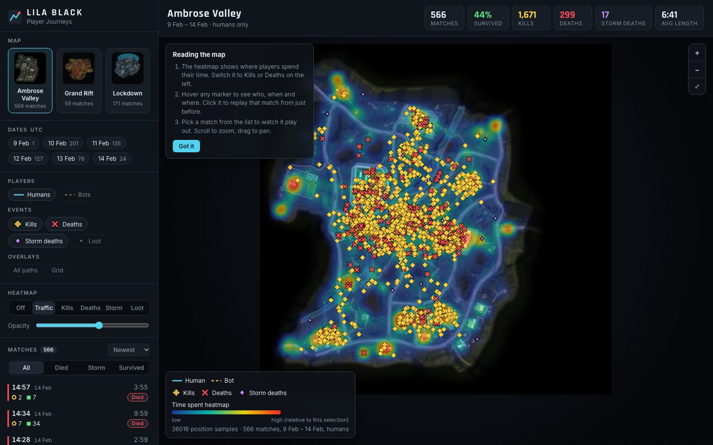
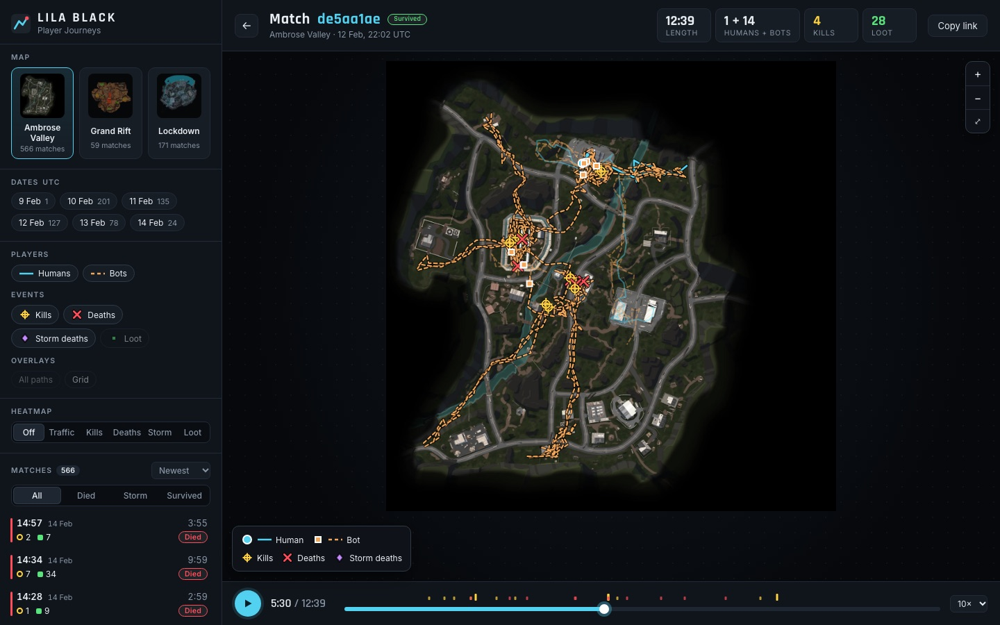

# LILA BLACK · Player Journeys

A map tool for LILA BLACK's level designers. Pick a map and some dates, and it shows where players spent their time, where they fought, died and looted, and lets you replay any single match on the minimap.

Live: **https://lila-player-journeys-one.vercel.app**



## Walkthrough

1. Open the link. You land on Ambrose Valley with a time-spent heatmap and every human kill, death and storm death from all 566 matches. Bots are one click away under Players. The cards along the top summarise whatever is on screen.
2. Use the map cards on the left to switch between Ambrose Valley, Grand Rift and Lockdown. Click a date chip to look at one day only, and click more chips to add days back.
3. Change the heatmap to Kills, Deaths, Storm or Loot. Comparing Traffic with Deaths is the quickest way to find spots that are busy but safe, or quiet but deadly.
4. Hover any marker to see what happened, who it was (human or bot), when, and the world x/z. Click it and that match opens 20 s before the event, plays up to it and pauses.
5. Or pick a match from the list. Filter by how the human's run ended (died / storm / survived) and sort by newest, longest, shortest, most kills or most loot.
6. In a match: play/pause, scrub, change speed (1–40×), or click a tick on the timeline to jump to a fight. Humans are solid cyan lines with round markers, and bots are dashed orange lines with square ones.
7. Turn on the Grid (A–J / 1–10) to talk about places, e.g. "the pit at E6". Copy link shares the exact match and moment.

Shortcuts in a match: `space` play/pause, `←` `→` step 5 s, `esc` back to the overview. Scroll to zoom, drag to pan, double-click to reset the view.



## Docs

- [ARCHITECTURE.md](ARCHITECTURE.md): stack, data flow, how world coordinates map onto the minimap, the data quirks I hit, and trade-offs.
- [INSIGHTS.md](INSIGHTS.md): three things the tool shows about the maps, with numbers and suggested changes.

## Tech stack

- Data pipeline: Python 3.10+, pyarrow, Pillow
- Frontend: React 19, TypeScript, Vite. Plain canvas for the map, no map or chart libraries.
- Hosting: Vercel (static)

## Running locally

```bash
npm install
npm run dev          # http://localhost:5173
```

The processed data is committed under `public/data`, so the app runs without the raw files.

To rebuild that data from `player_data.zip`:

```bash
unzip player_data.zip -d data/          # data/player_data/February_10/... and minimaps/
python3 -m venv .venv && source .venv/bin/activate
pip install -r pipeline/requirements.txt
npm run data                            # writes public/data/*.json and public/minimaps/*.webp
python pipeline/test_build.py           # coordinate, bot-detection and cleanup checks
```

The raw zip isn't in the repo. It's production telemetry, and the app only needs the processed output.

Environment variables: none. The app is static, and the pipeline takes `--src` and `--out` (defaults `data/player_data` and `public`).

## Deploying

The repo is connected to a Vercel project using the Vite preset (`npm run build`, output `dist`), so every push to `main` redeploys. Any static host works the same way: run `npm run build` and serve `dist/`.

## Code layout

```
pipeline/build.py        parquet → cleaned JSON + resized minimaps
pipeline/test_build.py   checks for the transform and the data cleanup
src/data.ts              data types, loading, time and coordinate helpers
src/heatmap.ts           binning, blur and colour ramp for the heatmaps
src/MapCanvas.tsx        the map: pan/zoom, paths, markers, hover and click
src/Sidebar.tsx          map/date/layer filters and the match list
src/TopBar.tsx           summary numbers for the current view
src/Timeline.tsx         playback controls
src/markers.ts           marker shapes and colours, shared by the map and the legend
```
